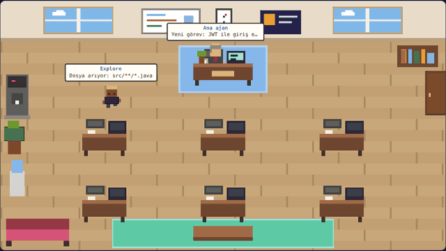

# ajan-ofisi


Claude Code alt ajan kullanırken arkada ne olduğunu görmek istedim: hangi ajan hangi dosyayı okuyor, kim komut çalıştırıyor, kim ne zaman bitiriyor. Bu proje Claude Code'un hook olaylarını alıp kaydediyor ve hepsini piksel art bir ofiste canlı gösteriyor. Ana ajan patron masasında oturuyor, her alt ajan kapıdan girip bir masaya geçiyor, işi bitince kahvesini alıp çıkıyor.



## Teknolojiler

| Alan | Seçim |
|---|---|
| Dil / framework | Java 21, Spring Boot 3.5 |
| Web | Spring Web, Bean Validation, Actuator |
| Canlı yayın | Server-Sent Events (`SseEmitter`) |
| Veritabanı | PostgreSQL 17, Spring Data JPA, Flyway |
| Güvenlik | Spring Security, `X-Hook-Token` başlığıyla durumsuz kimlik doğrulama |
| API dokümantasyonu | springdoc-openapi, Swagger UI |
| Arayüz | Tek sayfa, saf JavaScript ve `<canvas>`; kütüphane yok |
| Test | JUnit 5, AssertJ, Mockito, Testcontainers |
| Dağıtım | Docker (multi-stage), docker-compose, GitHub Actions |

## Özellikler

- **Claude Code'a HTTP hook ile bağlanır.** Ek betik gerekmiyor: Claude Code her olayı JSON olarak doğrudan `POST /api/hooks` adresine gönderiyor. API her zaman `{"continue": true}` dönüyor, yani ofis sadece izliyor; ajanın işini hiçbir zaman durdurmuyor ya da değiştirmiyor.
- **Sekiz olay türü çiziliyor:** oturum açılıp kapanması, yeni görev, araç kullanımı (dosya okuma, düzenleme, komut, arama), alt ajanın gelişi ve bitişi, onay beklenmesi ve cevabın hazır olması. Diğer hook olayları kabul ediliyor ama saklanmıyor.
- **Sadece kısa etiketler saklanıyor.** Dosya içerikleri, düzenleme farkları ve görevin tamamı saklanmıyor; dosya adı, komut açıklaması ve görevin ilk 120 karakteri yetiyor. URL'lerden sadece alan adı alınıyor, çünkü sorgu dizesinde token olabilir.
- **Canlı yayın SSE ile.** Olay veritabanına yazılıp transaction commit edildikten sonra (`@TransactionalEventListener(AFTER_COMMIT)`) bütün açık sekmelere gönderiliyor. Kapanmış sekmeler ilk yazma hatasında listeden çıkarılıyor.
- **Sayfa yenilenince ofis geçmişten yeniden kuruluyor:** son oturumun olayları okunuyor, çalışan ajanlar masalarına oturtuluyor, sonra canlı akışa bağlanılıyor.
- **Sahne:** 6 masa, kahve köşesi, toplantı alanı (6'dan fazla ajan aynı anda çalışırsa fazlası burada ayakta çalışıyor), gerçek saate göre gündüz, akşam ve gece pencereleri, duvarda gerçek saati gösteren saat. Oturum kapanınca ışıklar sönüyor. Claude Code bağlı değilken de **demo modu** ile ofisi izleyebiliyorsun.
- **Eski olaylar her gece siliniyor** (varsayılan 7 gün, `EVENT_RETENTION`).
- **Tüm hatalar RFC 9457 problem detail** biçiminde, 401 de dahil.

## Çalıştırma

### Docker Compose ile

```bash
cp .env.example .env
# .env içine bir token yaz:
openssl rand -hex 24
docker compose up --build
```

Ofis: http://localhost:8080 · Swagger UI: http://localhost:8080/swagger-ui.html

Compose uygulamayı sadece `127.0.0.1` üzerinde yayınlıyor. Sayfada giriş yok, o yüzden ağdaki başka bilgisayarlar ofisi göremiyor.

### IDE'den

```bash
docker compose up -d db
mvn spring-boot:run   # ya da IDE'den AjanOfisiApplication
```

## Claude Code'a bağlama

1. Token'ı Claude Code'un göreceği bir ortam değişkeni olarak ayarla (`.env` içindekiyle aynı değer):

   ```bash
   # macOS / Linux: ~/.bashrc ya da ~/.zshrc
   export AJAN_OFISI_TOKEN=<token>
   ```

   ```powershell
   # Windows
   setx AJAN_OFISI_TOKEN "<token>"
   ```

2. [`hooks/claude-settings.json`](hooks/claude-settings.json) içindeki `hooks` bölümünü Claude Code ayarlarına ekle: bütün projeler için `~/.claude/settings.json`, tek bir proje için o projenin `.claude/settings.local.json` dosyası. Dosyada zaten `hooks` varsa olayları mevcut listelere ekle.

3. Claude Code'u yeniden başlat ve alt ajan kullanan bir görev ver (örneğin "Explore ajanıyla kod tabanını tara, sonra testleri yaz"). Ajanlar ofise girmeye başlayacak.

Token header'a `allowedEnvVars` ile ekleniyor; Claude Code sadece bu listedeki değişkenleri header'a yazıyor. Uygulama kapalıyken hook'lar 3 saniyede zaman aşımına uğruyor ve Claude Code çalışmaya devam ediyor (HTTP hook hataları engelleyici değil).

## Ayarlar

| Değişken | Varsayılan | Amaç |
|---|---|---|
| `AJAN_OFISI_TOKEN` | `dev-only-hook-token-change-me` | Claude Code'un `X-Hook-Token` başlığında gönderdiği gizli değer, en az 16 karakter |
| `DB_URL` | `jdbc:postgresql://localhost:5432/ajanofisi` | Veritabanı adresi |
| `DB_USERNAME` / `DB_PASSWORD` | `ajanofisi` / `ajanofisi` | Veritabanı kullanıcısı |
| `EVENT_RETENTION` | `7d` | Olayların saklanma süresi |
| `STREAM_TIMEOUT` | `30m` | Bir SSE bağlantısının ömrü; tarayıcı sonra kendisi yeniden bağlanıyor |
| `STREAM_HEARTBEAT` | `PT20S` | Boştaki bağlantıyı proxy'ler kapatmasın diye gönderilen boş yorumun aralığı |
| `PORT` | `8080` | HTTP portu |
| `LOG_LEVEL` | `info` | `com.semih.ajanofisi` log seviyesi |

## API

| Metot | Yol | Erişim | Açıklama |
|---|---|---|---|
| `POST` | `/api/hooks` | `X-Hook-Token` | Claude Code hook olayını alır, `{"continue": true}` döner |
| `GET` | `/api/sessions` | Açık | Oturumlar, en son etkin olan önce (`page`, `size`) |
| `GET` | `/api/sessions/{sessionId}/events` | Açık | Oturumun olayları zaman sırasıyla (en yeni 500) |
| `GET` | `/api/stream` | Açık | Server-Sent Events; her yeni olay `office-event` adıyla gelir |
| `GET` | `/actuator/health` | Açık | Sağlık kontrolü |

Claude Code'un gönderdiğine benzer bir olay:

```bash
curl -X POST http://localhost:8080/api/hooks \
  -H "Content-Type: application/json" \
  -H "X-Hook-Token: $AJAN_OFISI_TOKEN" \
  -d '{"session_id": "abc123", "hook_event_name": "PreToolUse", "agent_id": "agent-1",
       "agent_type": "Explore", "tool_name": "Read",
       "tool_input": {"file_path": "/home/semih/site-api/src/UserService.java"}}'
```

```json
{"continue": true}
```

Sayfaya giden olay:

```json
{
  "id": 42,
  "sessionId": "abc123",
  "type": "TOOL",
  "agentId": "agent-1",
  "agentType": "Explore",
  "toolName": "Read",
  "detail": "UserService.java",
  "createdAt": "2026-11-23T10:15:02.481Z"
}
```

Token olmadan:

```json
{
  "type": "about:blank",
  "title": "Unauthorized",
  "status": 401,
  "detail": "A valid X-Hook-Token header is required",
  "instance": "/api/hooks",
  "timestamp": "2026-11-23T10:15:02.481Z"
}
```

## Proje yapısı

```
src/main/java/com/semih/ajanofisi
├── AjanOfisiApplication.java
├── hook/       HookController ve Claude Code'un JSON'u için HookPayload, HookAck
├── office/     olayın kendisi: OfficeEvent (entity), OfficeEventType (hook → olay eşlemesi),
│               ToolSummarizer (araç çağrısından tek etiket), OfficeEventService, oturum uçları,
│               gece temizliği
├── stream/     OfficeStream (açık SSE bağlantıları, commit sonrası yayın, heartbeat), StreamController
├── security/   SecurityConfig, HookTokenFilter, 401 için ProblemDetailSecurityHandler
├── common/     GlobalExceptionHandler, Problems, Texts (kısaltma, yol parçası)
└── config/     Clock, zamanlayıcı, sayfalama, OpenAPI
src/main/resources
├── db/migration/   Flyway: V1__create_office_events.sql
└── static/         index.html, js/office.js (sahne), css/office.css, favicon seti, robots.txt, llms.txt
hooks/claude-settings.json   Claude Code'a eklenecek HTTP hook ayarları
```

## Testler

```bash
mvn verify
```

- **Birim testleri:** `ToolSummarizer` (hangi araçtan ne gösteriliyor, dosya içeriğinin ve URL sorgusunun dışarıda kalması), `OfficeEventService` (kayıt, yayın, kısaltma, yok sayılan olaylar, zaman sırası, temizlik), `OfficeStream` (bağlantı ekleme, herkese yayın, kapanan sekmenin düşürülmesi), `Texts` ve hook eşlemesi.
- **Entegrasyon testi** (Testcontainers ile gerçek PostgreSQL): token yok ya da yanlışsa 401, eksik alanlarda 400, bir alt ajanın baştan sona akışı, oturum sırası, yok sayılan olaylar, 404, SSE bağlantısı, sayfa ve ikonların sunulması. Docker yoksa bu testler atlanıyor.

## Neler öğrendim

- **SSE ile WebSocket arasındaki seçim:** Veri sadece sunucudan sayfaya akıyor. SSE düz HTTP üzerinde çalışıyor, tarayıcıdaki `EventSource` kopan bağlantıyı kendisi yeniden kuruyor ve Spring'de tek bir `SseEmitter` yetiyor. Çift yönlü iletişim gerekseydi WebSocket seçerdim.
- **Olayı commit'ten sonra yayınlamak:** Kaydı yaparken hemen yayınlasaydım, transaction geri alındığında sayfa hiç var olmamış bir olayı gösterirdi. `@TransactionalEventListener(phase = AFTER_COMMIT)` bunu çözüyor.
- **Makineden makineye kimlik doğrulama:** Burada giriş yapan bir insan yok, bu yüzden JWT gereksiz. Uzun, rastgele bir token ve `MessageDigest.isEqual` ile sabit sürede karşılaştırma yeterli (karşılaştırma süresi kaç karakterin doğru olduğunu ele vermesin).
- **Gelen veriyi süzmek:** Hook olayları bütün dosya içeriklerini ve görevin tamamını taşıyabiliyor. Ekranda sadece bir ipucu gerektiği için sadece etiketi saklıyorum; hem tablo küçük kalıyor hem de gizli bir şey veritabanına girmiyor.
- **Windows yolu, Linux sunucu:** Claude Code Windows'ta çalışıp API Docker'da çalışınca `Path.of("C:\\Users\\...")` yolu bölmüyor. Proje adını iki ayırıcıya göre kendim ayırıyorum.

## Yol haritası

- [x] Claude Code HTTP hook'larını alma ve kaydetme
- [x] SSE ile canlı yayın, sayfa yenilenince geçmişten kurulum
- [x] Piksel art ofis: 6 masa, kahve köşesi, toplantı alanı, gece/gündüz, demo modu
- [ ] Aynı anda çalışan birden fazla Claude Code oturumu için ayrı katlar
- [ ] Oturum seçici ve geçmiş bir oturumu baştan oynatma
- [ ] Alt ajan türüne göre özel karakterler (Explore dürbünlü, test yazarı kontrol listeli)
- [ ] Ajan başına süre ve araç sayısı istatistikleri

## Lisans

[MIT](LICENSE) © 2026 Semih Eren
